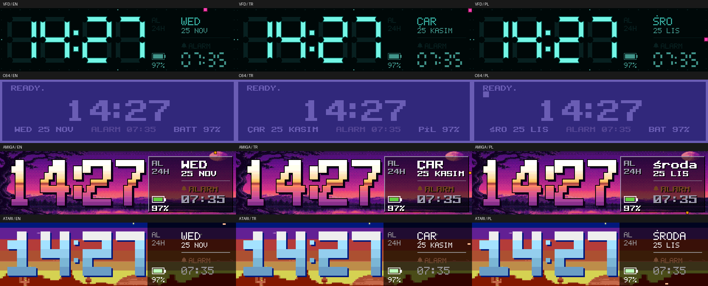
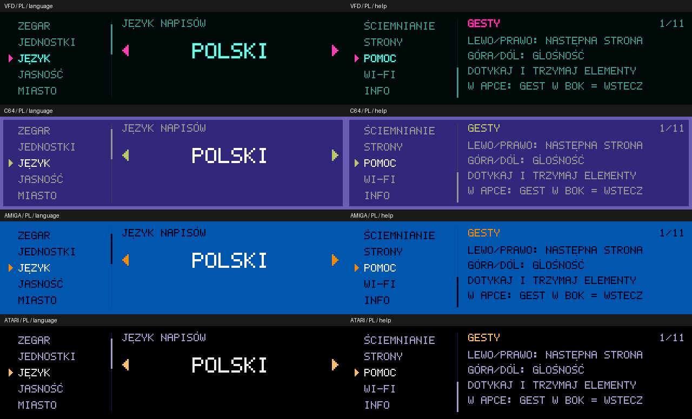

# Screen localization

The firmware keeps English text in the code and looks it up in the selected
language's table. English is the fallback for a missing translation. Turkish
and Polish have sorted tables in `LangTr.cpp` and `LangPl.cpp`; the language
registry and date words live in `Lang.h` / `Lang.cpp`.

- `T("TEXT")` translates a literal or an `N_()`-marked table entry.
- `TCTX("context", "TEXT")` distinguishes meanings that share English text.
- `N_("TEXT")` marks text stored in a menu/struct for later translation.
- `lang=en`, `lang=tr` and `lang=pl` are saved in the existing settings format.
  Existing EN/TR settings remain valid; unknown language codes select English.

## Adding a language

1. Add a language ID and `Data` record, register it in `ALL`, and provide the
   language name, code, date words and sorted translation table.
2. Keep each key's `printf` conversions in the same order as English. Context
   keys use the same `context\004text` convention as `TCTX`.
3. Add the language choice/translations to the browser settings page.
4. Supply its letters in the VFD code-point resolver and the generated C64 /
   Amiga font source. Atari uses the VFD glyph set. Keep generated font data in
   sync with `design/themes/src/fonts.js`.
5. Run the checks below, build the firmware and inspect the affected views in
   all four themes. Longer translations can fit differently depending on font,
   wrapping and the space available in each view.

## Checks

```bash
python3 tools/check_i18n.py
python3 tools/test_check_i18n.py
g++ -std=c++17 -O2 -Wall -Wextra -Wformat=2 -o /tmp/lang_test \
  firmware/test/lang_test.cpp firmware/src/boards/touch349/gadget/Lang*.cpp
/tmp/lang_test
```

The checker verifies registry/table agreement, sorted unique keys, completeness,
format conversions, UTF-8, glyph coverage and browser language choices. It runs
before firmware compilation; CI also runs its 31 regression tests and the C++
language runtime test. At introduction there are 279 keys in each translated
table, no checker errors and 11 heuristic length warnings. Those warnings are
not layout measurements.

## Representative device previews

Captured from `GET /screen` on a Waveshare ESP32-S3-Touch-LCD-3.49 V2 at its
native 640x172 resolution. The device ran firmware with these localization
changes; the isolated localization PR was built separately. Each language was
confirmed in `/api/settings` before capturing it, and the original settings,
theme and page were restored afterwards.

EN / TR / PL across VFD, C64, Amiga and Atari:



Polish language selection and help in all four themes:



These twenty representative captures check language switching, date labels and
accented glyphs in the selected views. They are not an exhaustive visual test
of every game dialogue, weather condition or settings state.
